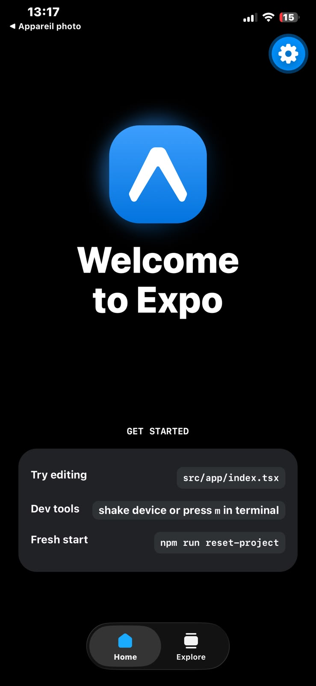

# My Restaurant – Lab 6

Application mobile simple développée avec **React Native** et **Expo**.
Elle affiche le menu d'un restaurant organisé par sections.

## Capture d'écran



## Fonctionnalités

- En-tête avec le nom du restaurant
- Menu organisé en 4 sections : Appetizers, Main Dishes, Sides, Desserts
- Affichage du nom et du prix de chaque plat avec `SectionList`
- Pied de page (footer)

## Structure du projet

```
src/
├── app/
│   └── index.tsx          # Écran principal
└── components/
    ├── AppHeader.js       # En-tête
    ├── MenuItems.js       # Liste du menu (SectionList)
    └── AppFooter.js       # Pied de page
```

## Installation et lancement

1. Installer les dépendances :

   ```bash
   npm install
   ```

2. Lancer l'application :

   ```bash
   npx expo start
   ```

3. Scanner le QR code avec l'application **Expo Go** sur le téléphone.

## Technologies

- React Native
- Expo (Expo Router)
- JavaScript / TypeScript

## Auteur

Nom : _à compléter_
